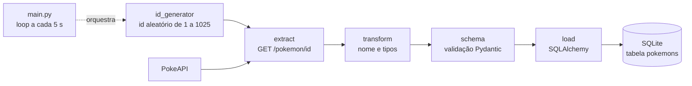

# Pipeline ETL da PokeAPI

**Página no portfólio:** https://dev-pprado.github.io/projetos/pokemon-etl/

Pipeline em Python que extrai dados da [PokeAPI](https://pokeapi.co/), transforma, valida com Pydantic e carrega em SQLite com SQLAlchemy. A aplicação em si é simples (nome e tipos de um Pokémon por execução). O objetivo do projeto é a estrutura: cada etapa em um módulo próprio, com logging e tratamento de erros, para servir de base aos próximos pipelines de estudo.

## O pipeline



| Etapa | Código | O que faz |
|---|---|---|
| **ID** | [`src/utils/id_generator.py`](src/utils/id_generator.py) | Sorteia um id entre 1 e 1025. |
| **Extract** | [`src/extract/pokemon_api.py`](src/extract/pokemon_api.py) | Chama `GET {POKEAPI_URL}/pokemon/{id}` com `requests` e devolve o JSON bruto. Erros HTTP sobem como exceção. |
| **Transform** | [`src/transform/pokemon.py`](src/transform/pokemon.py) | Pega o nome e junta os tipos em uma string (`"grass, poison"`). |
| **Schema** | [`src/schemas/pokemon.py`](src/schemas/pokemon.py) | `PokemonSchema` (Pydantic) valida os campos antes da persistência. |
| **Load** | [`src/load/pokemon_db.py`](src/load/pokemon_db.py) | Grava na tabela `pokemons` pelo modelo SQLAlchemy em [`src/models/pokemon.py`](src/models/pokemon.py). |

O [`src/main.py`](src/main.py) só orquestra: cria a tabela se ela ainda não existir e chama as etapas em ordem, em loop, com uma pausa de 5 segundos entre as execuções.

### Tabela `pokemons`

| Coluna | Tipo | Regra |
|---|---|---|
| `id` | Integer | Chave primária |
| `name` | String | |
| `type` | String | Tipos separados por vírgula |
| `created_at` | DateTime | Preenchido com `now()` na inserção |

### Decisões de engenharia

- **Uma responsabilidade por módulo:** extract não sabe do banco e load não sabe da API. Dá para trocar a fonte ou o destino mexendo em um módulo só.
- **Validação antes da carga:** os dados passam pelo `PokemonSchema` antes de chegar ao SQLAlchemy, então um registro fora do contrato não vai para o banco.
- **Falha isolada por execução:** cada iteração roda dentro de um `try/except`. Se a API ou o banco falharem, o erro é registrado com traceback e o loop segue para a próxima execução.
- **Logs:** cada etapa usa `logging` com o formato `data | nível | módulo | mensagem`, enviado ao terminal e ao arquivo `logs/pipeline.log`.
- **Configuração por ambiente:** URL da API, timeout e conexão do banco vêm do `.env` (via `python-dotenv`), não do código.
- **Teste:** um teste com pytest verifica que `init_db()` cria a tabela `pokemons`.

## Stack

| Parte | Tecnologias |
|---|---|
| Pipeline | Python 3.13, Requests, Pydantic, python-dotenv |
| Banco | SQLAlchemy, SQLite |
| Ferramentas | uv, pytest |

## Como rodar localmente

Pré-requisitos: Python 3.13+ e [uv](https://docs.astral.sh/uv/).

```sh
uv sync

# configuração
cp .env.example .env
```

Preencha o `.env`:

```env
POKEAPI_URL=https://pokeapi.co/api/v2
API_TIMEOUT=10
DATABASE_URL=sqlite:///src/pokemon.db
```

```sh
uv run python src/main.py     # roda o pipeline (Ctrl + C para parar)
uv run pytest                 # testes
```

A tabela é criada na primeira execução, então qualquer `DATABASE_URL` aceito pelo SQLAlchemy funciona.

## Estrutura

```text
.
├── src/
│   ├── main.py           # orquestra as etapas em loop
│   ├── config/           # settings.py (.env), database.py (engine e sessão), logging.py
│   ├── utils/            # id_generator.py
│   ├── extract/          # pokemon_api.py
│   ├── transform/        # pokemon.py
│   ├── schemas/          # pokemon.py (Pydantic)
│   ├── models/           # pokemon.py (SQLAlchemy)
│   ├── load/             # pokemon_db.py
│   └── pokemon.db        # banco SQLite de exemplo
├── tests/                # test_database_init.py
├── docs/                 # pipeline.png
├── .env.example
└── pyproject.toml
```

## Limitações conhecidas

- **Sem deduplicação:** o mesmo Pokémon pode ser sorteado mais de uma vez e é inserido de novo.
- **Poucos testes:** só a criação da tabela é testada.

## Próximos passos

- [ ] Testes de cada etapa (transform, schema e extract com a API simulada)
- [ ] Carga incremental, sem repetir registros
- [ ] Usar a mesma estrutura com outras fontes (banco de dados, arquivos Parquet)
- [ ] Orquestração com Airflow e execução em Docker
